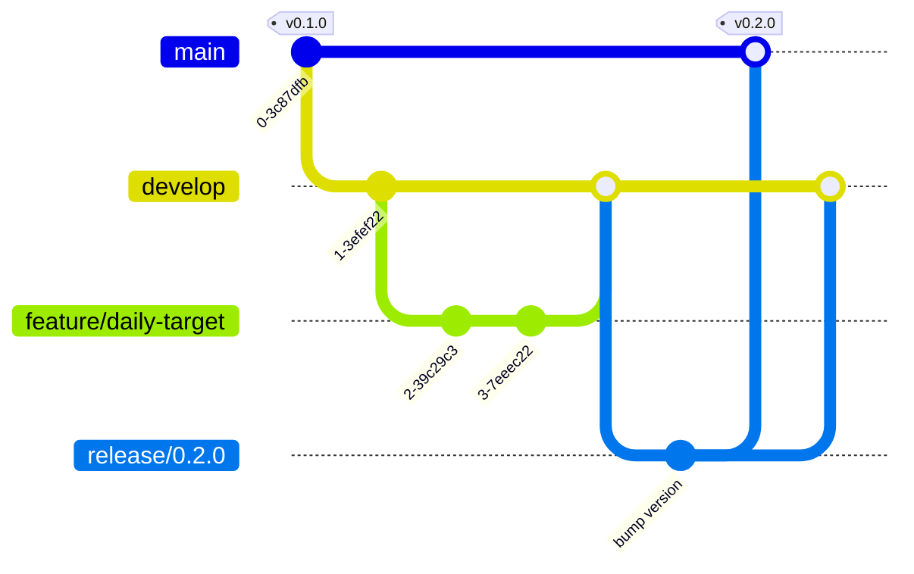

# Contributing

Thanks for helping improve HNB Solo Tracker.

## Branching model (Git Flow)

| Branch | Purpose | Branches from | Merges into |
|---|---|---|---|
| `main` | Released, production-ready code. Every release commit is tagged `vX.Y.Z`. | – | – |
| `develop` | Integration branch for the next release. | `main` | `release/*` |
| `feature/*` | New features, e.g. `feature/daily-target`. | `develop` | `develop` |
| `release/*` | Release preparation, e.g. `release/0.2.0`. Only bug fixes, version bump and changelog. | `develop` | `main` **and** `develop` |
| `hotfix/*` | Urgent fixes to a released version, e.g. `hotfix/0.1.1`. | `main` | `main` **and** `develop` |



### Starting a feature

```bash
git checkout develop
```

```bash
git checkout -b feature/my-feature
```

Commit your work, push the branch, then open a pull request into `develop`.

### Releasing

See [docs/RELEASING.md](docs/RELEASING.md).

## Commit messages

Use [Conventional Commits](https://www.conventionalcommits.org/):

```
feat: add daily target to count cards
fix: keep leading zeros in CSV export
docs: update database schema
```

## Development setup

- Rust stable (`rustup default stable`)
- Windows 10 or 11

```bash
cargo run
```

Before opening a pull request, run:

```bash
cargo fmt
```

```bash
cargo clippy -- -D warnings
```

```bash
cargo build --release
```

## Pull requests

- Keep each PR focused on one change.
- Fill in the [pull request template](.github/PULL_REQUEST_TEMPLATE.md).
- Add an entry under **Unreleased** in [CHANGELOG.md](CHANGELOG.md).
- Include a screenshot for UI changes.
- Never include real customer phone numbers in code, tests or screenshots.

## Code of conduct

By taking part you agree to follow the [Code of Conduct](CODE_OF_CONDUCT.md).
