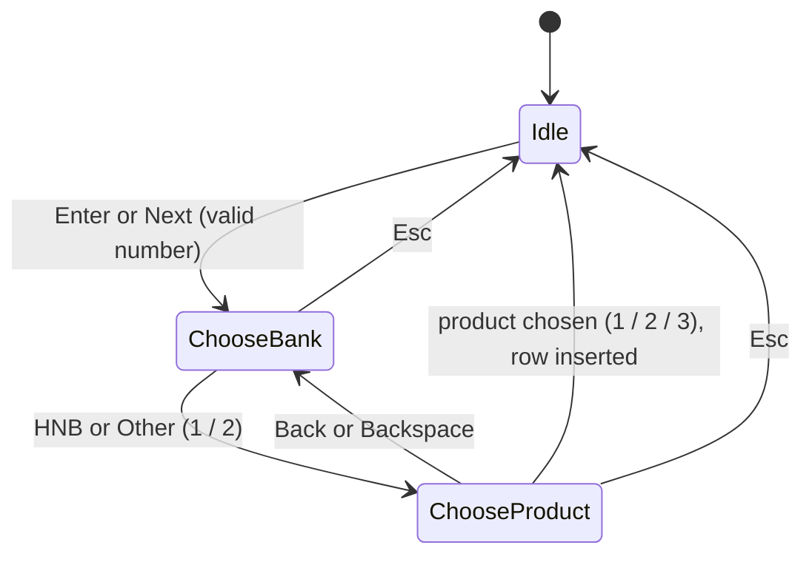
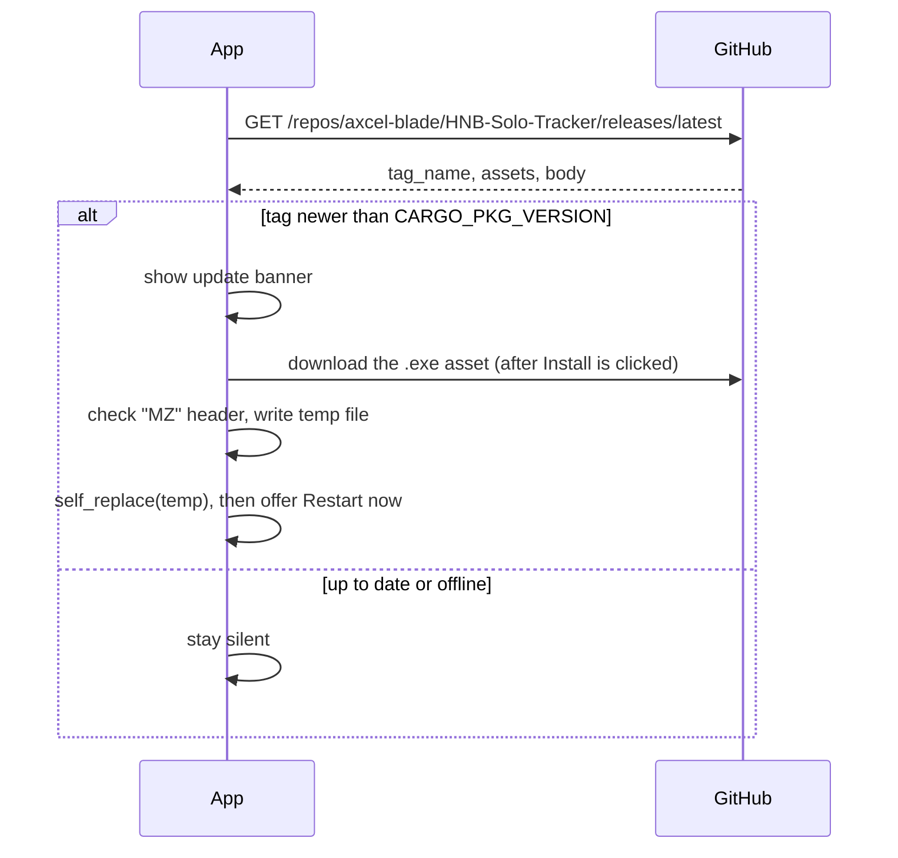

# Architecture

HNB Solo Tracker is a single native Windows executable written in Rust.

## Technology

| Concern | Choice |
|---|---|
| Language | Rust (2021 edition) |
| GUI | [egui](https://github.com/emilk/egui) / eframe 0.29 (immediate mode) |
| Icons | [egui-phosphor](https://github.com/amPerl/egui-phosphor) (Phosphor icon font) |
| Storage | SQLite via [rusqlite](https://github.com/rusqlite/rusqlite), bundled so nothing extra needs installing |
| File dialogs | [rfd](https://github.com/PolyMeilex/rfd) |
| Updates | [ureq](https://github.com/algesten/ureq), [semver](https://github.com/dtolnay/semver), [self-replace](https://github.com/mitsuhiko/self-replace) |
| Exe icon | [winresource](https://github.com/BenjaminRi/winresource) in `build.rs` |

## Source layout

```
.
├── assets/                          app icon (PNG for the window, ICO for the exe)
├── build.rs                         embeds assets/icon.ico into the exe
├── src/
│   ├── main.rs                      theme, data model, SQLite access, UI
│   └── updater.rs                   GitHub release check, download, self-replace
└── .github/workflows/release.yml    builds and publishes releases
```

## Components (`src/main.rs`)

| Part | Responsibility |
|---|---|
| `mod theme` | Colour tokens taken from hnb.lk |
| `Bank`, `Product` | Enums with label, icon, colour and database code |
| `Db` | Opens or creates the database, migrates old data, insert / delete / clear / list |
| `App` | UI state: cached entries, input text, current pop-up step, tab, status message |
| `App::header` | Brand bar, Export and Clear buttons, phone input |
| `App::summary_cards`, `columns_view`, `transactions_view` | Main views |
| `App::dialogs` | Bank and product pop-ups |
| `App::update_banner` | Update notification bar |
| Components | `surface`, `stat_card`, `choice_tile`, `pill`, `bank_tag`, `icon_badge`, buttons |

## Entry flow



The current step is held in the `Step` enum. When a product is chosen, the row is written to SQLite and the in-memory list is reloaded, so the database is always the source of truth.

## Rendering model

egui redraws the whole UI each frame from the `App` state. Counts are computed from the in-memory `entries` list, which stays small (thousands of rows at most), so no caching is needed.

## Update flow (`src/updater.rs`)



Network work runs on background threads and shares state through `Arc<Mutex<State>>`, so the UI thread is never blocked.

## Release pipeline

Pushing a tag `vX.Y.Z` runs `.github/workflows/release.yml` on `windows-latest`. It builds in release mode and attaches `hnb-solo-tracker-vX.Y.Z-windows-x64.exe` to a GitHub release. See [RELEASING.md](RELEASING.md).
