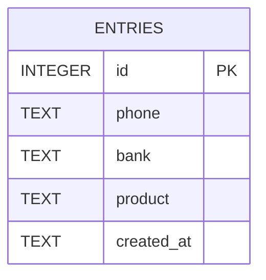

# Database

## Location

```
%APPDATA%\HNB Solo Tracker\hnb_solo_tracker.db
```

The database is created automatically on first start. It runs in SQLite WAL mode, so `-wal` and `-shm` files appear next to it while the app is open.

## Schema

```sql
CREATE TABLE IF NOT EXISTS entries (
    id         INTEGER PRIMARY KEY AUTOINCREMENT,
    phone      TEXT NOT NULL,
    bank       TEXT NOT NULL,
    product    TEXT NOT NULL,
    created_at TEXT NOT NULL
);

CREATE INDEX IF NOT EXISTS idx_entries_product ON entries(product);
```



### `entries`

| Column | Type | Description |
|---|---|---|
| `id` | INTEGER | Auto-increment primary key |
| `phone` | TEXT | Phone number, digits and `+` only. Stored as text so leading zeros are kept. |
| `bank` | TEXT | `HNB` or `OTHER` |
| `product` | TEXT | `SOLO_MAX`, `SOLO_CARD` or `SOLO_BANK_ACC` |
| `created_at` | TEXT | Local time, `YYYY-MM-DD HH:MM:SS` |

### `settings`

| Column | Type | Description |
|---|---|---|
| `key` | TEXT | Primary key. The app uses the single key `app`. |
| `value` | TEXT | JSON with the user's settings |

```sql
CREATE TABLE IF NOT EXISTS settings (
    key   TEXT PRIMARY KEY,
    value TEXT NOT NULL
);
```

Example `value`:

```json
{"staff_name":"","branch":"","min_digits":9,"max_digits":12,"duplicate_policy":"Warn","ui_scale":1.0,"check_updates_on_start":true,"export_folder":""}
```

Missing fields fall back to their defaults, so older settings keep working after an update.

### Code values

| Code | Shown in the app |
|---|---|
| `HNB` | HNB |
| `OTHER` | Other Bank |
| `SOLO_MAX` | Solo Max |
| `SOLO_CARD` | Solo Credit/Debit Card |
| `SOLO_BANK_ACC` | Solo Bank Acc |

## Useful queries

Counts per product and bank:

```sql
SELECT product, bank, COUNT(*) AS total
FROM entries
GROUP BY product, bank
ORDER BY product, bank;
```

Today's entries:

```sql
SELECT * FROM entries
WHERE date(created_at) = date('now', 'localtime');
```

Numbers recorded more than once for the same product:

```sql
SELECT phone, product, COUNT(*) AS times
FROM entries
GROUP BY phone, product
HAVING times > 1;
```

You can open the file with [DB Browser for SQLite](https://sqlitebrowser.org/). Close the app first to avoid locking issues.

## Migration from `data.json`

Early builds stored data in `%APPDATA%\HNB Solo Tracker\data.json`. On start-up, if that file exists, every entry is imported into `entries` and the file is renamed to `data.json.migrated`, so the import runs only once.

## Backup and restore

- **Backup:** use **Settings → Data → Back up database**, which saves a consistent copy while the app is open. Or close the app and copy `hnb_solo_tracker.db`.
- **Restore:** close the app and replace the file with your backup.

## Privacy

The database holds customer phone numbers. Keep the Windows account protected and follow your bank's data-protection rules when copying the file or exported CSVs.
